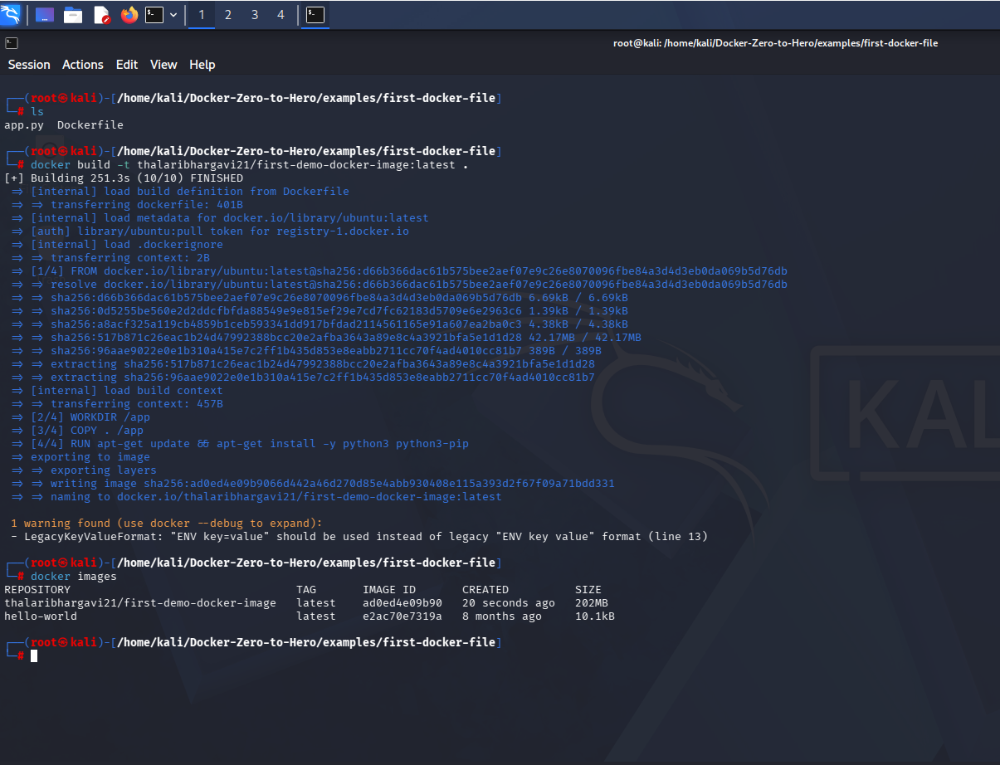
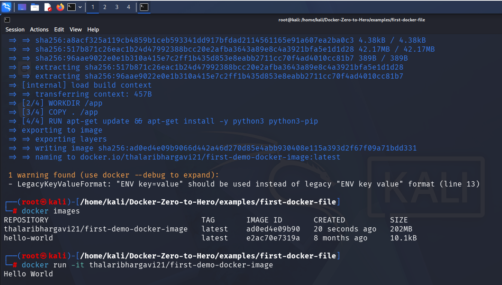
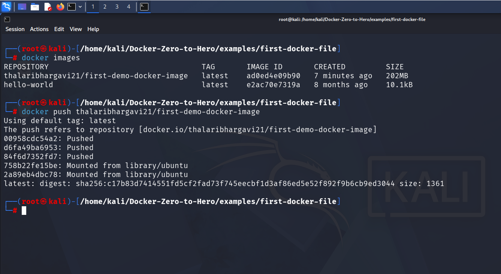
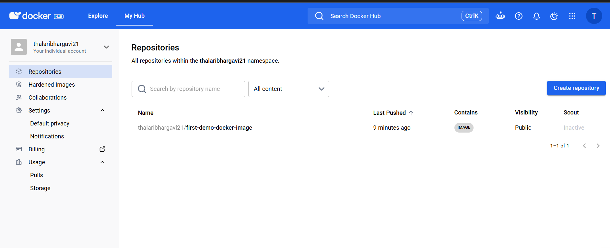
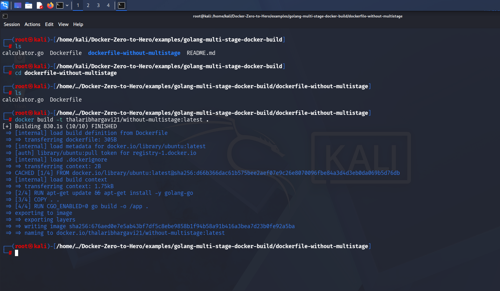
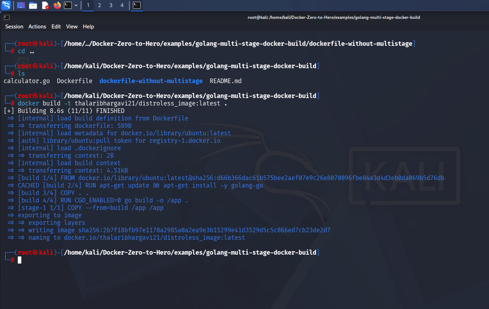
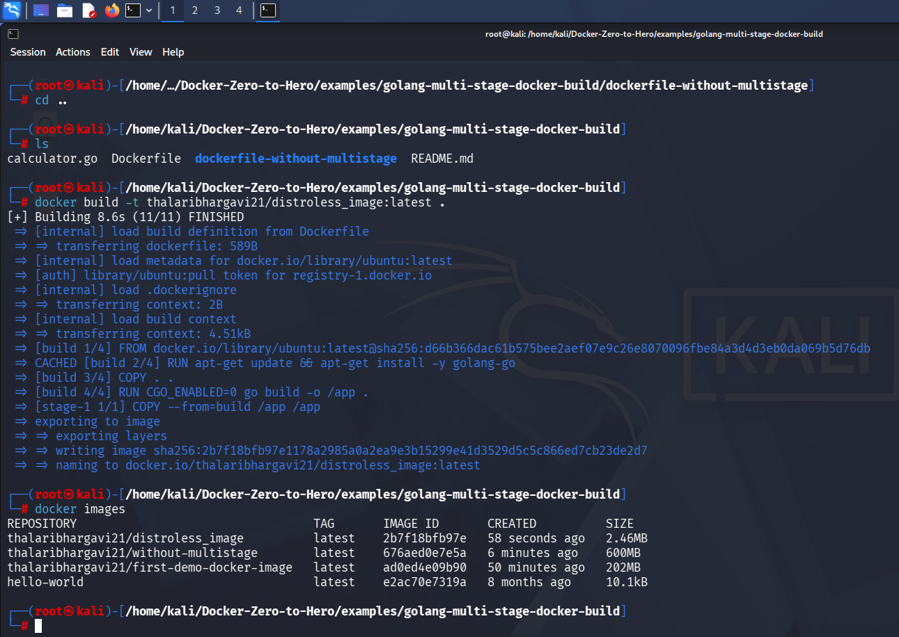

# 🐳 Docker Hands-on Practicals

## Project Overview

This document showcases my hands-on implementation of Docker concepts as part of my DevOps learning journey.

The practicals cover Docker image creation, container execution, Docker Hub integration, multi-stage builds, distroless images and image-size optimization.

---

## 1. Docker Image Creation

### Objective
Build a custom Docker image using a Dockerfile.

### Concepts Covered
- Base images
- WORKDIR
- COPY
- RUN
- ENV
- CMD
- Dockerfile instructions

### Command Used

```bash
docker build -t first-demo-docker-image .
```

### Screenshot



---

## 2. Running Docker Containers

### Objective
Run a container using the custom-built Docker image and verify the application output.

### Command Used

```bash
docker run -it first-demo-docker-image
```

### Screenshot



---

## 3. Docker Hub Integration

### Objective
Push the locally built Docker image to Docker Hub and verify the published repository.

### Commands Used

```bash
docker login

docker push thalaribhargavi21/first-demo-docker-image:latest
```

### Screenshots

**Pushing Docker Image to Docker Hub**



**Docker Hub Repository**



### Docker Hub Repository

[View My Docker Image on Docker Hub](https://hub.docker.com/r/thalaribhargavi21/first-demo-docker-image)

---

## 4. Multi-Stage Docker Builds

### Objective
Understand how multi-stage Docker builds separate build-time dependencies from runtime dependencies.

### Concepts Covered
- Build stages
- Runtime stages
- Separating build dependencies
- Reducing unnecessary image contents

### Screenshot – Without Multi-Stage Build



---

## 5. Distroless Images

### Objective
Explore minimal runtime images using distroless images.

### Concepts Covered
- Minimal container images
- Reduced runtime dependencies
- Smaller attack surface

### Screenshot



---

## 6. Docker Image Size Comparison

### Objective
Compare Docker image sizes from the practical experiments.

| Build Approach | Observed Image Size |
|---|---:|
| Without Multi-Stage Build | 600 MB |
| Minimal Multi-Stage Build | 2.46 MB |

### Screenshot



> **Note:** These are the image sizes observed during my practical implementation.

---

## 7. Key Learnings

- Building custom Docker images using Dockerfiles.
- Creating and running Docker containers.
- Publishing Docker images to Docker Hub.
- Understanding multi-stage Docker builds.
- Exploring distroless images.
- Comparing Docker image sizes.
- Understanding container image optimization.

---

## 8. Tools and Technologies Used

| Tool | Purpose |
|---|---|
| Docker Engine | Building and running containers |
| Docker Hub | Storing and sharing Docker images |
| Kali Linux | Practical environment |
| Git | Version control |
| GitHub | Project hosting and documentation |

---

## Conclusion

These hands-on exercises helped me understand Docker fundamentals, containerization, Docker image creation and image optimization.

This is part of my continuous journey towards learning DevOps and cloud technologies.

**Learning by doing! 🚀**

